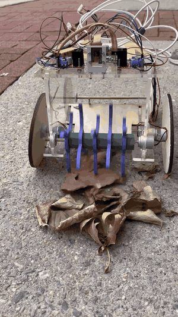
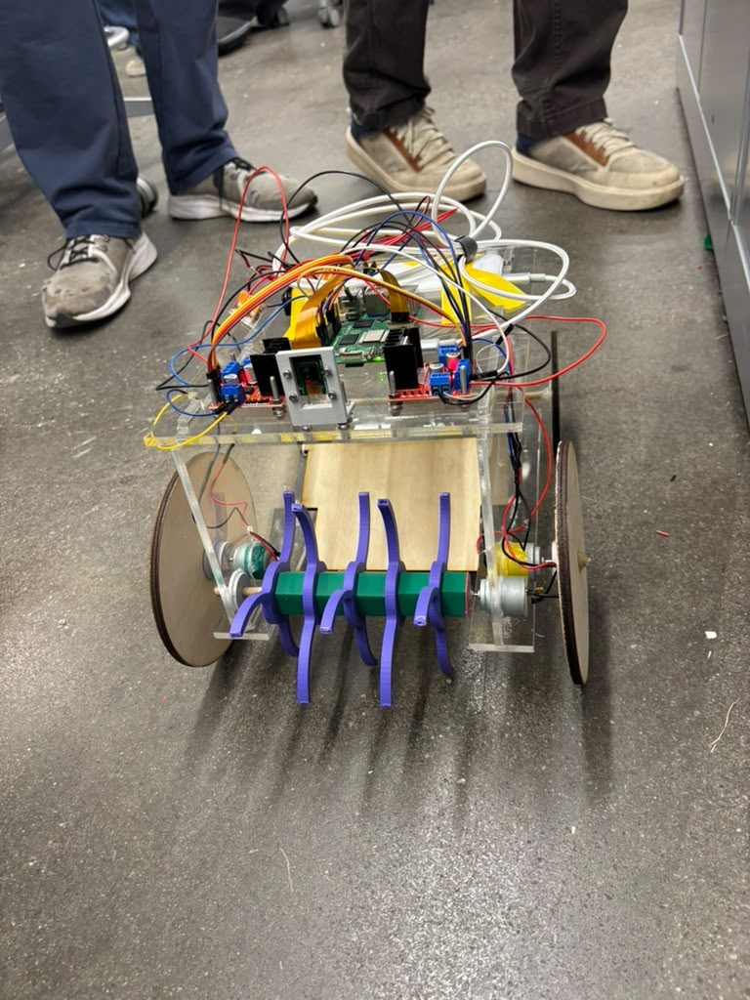
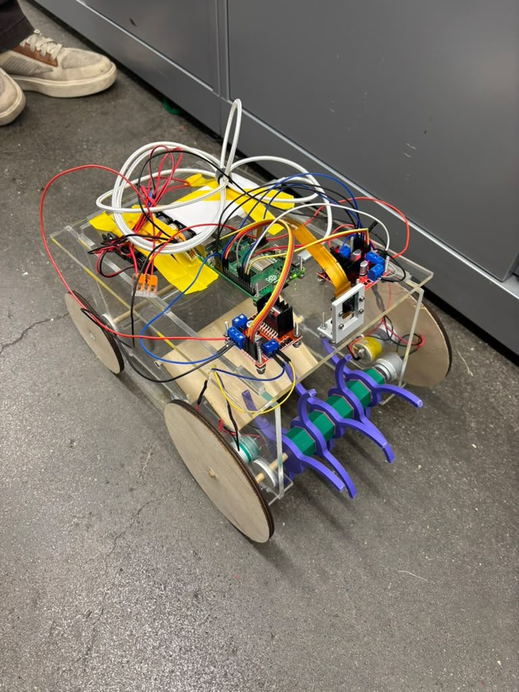
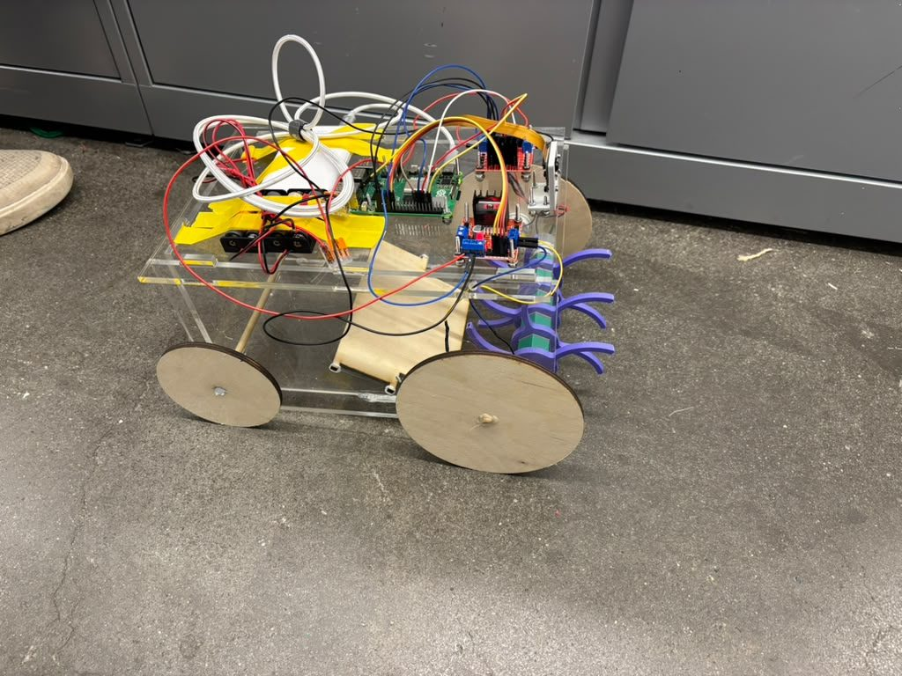
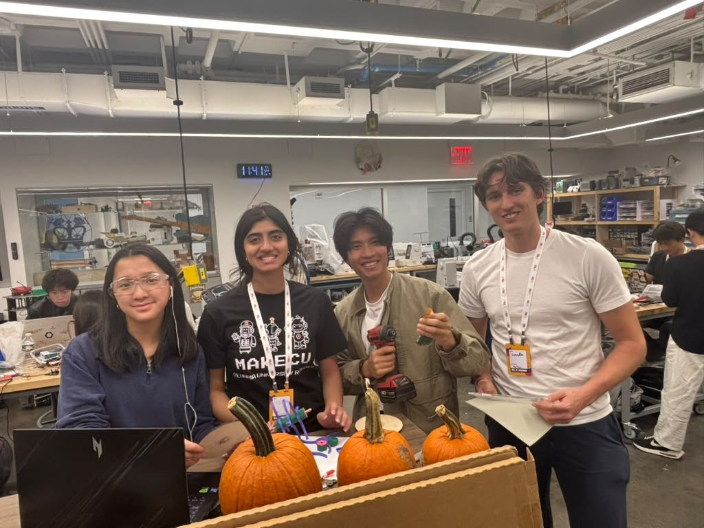

# Leaf Compost Collector

**An autonomous robot that finds fallen leaves with a camera, rakes them into an onboard bin, and saves them for compost instead of the landfill.**

Built in one weekend at [MakeCU 2026](https://makecu2026.devpost.com/) (Columbia University), Environmental and Sustainability track.

<p align="center">
  
</p>

[Devpost](https://devpost.com/software/leaf-compost-collector) · [Demo video](https://www.youtube.com/watch?v=4_0j8XnGMl8) · [Code](software/)

---

## Why

Every fall, leaves get cleared with loud, dusty leaf blowers or raked by hand, which is hard work for older adults and anyone with a bad back. Much of what gets collected ends up in the trash. In 2018, US landfills received about 10.5 million tons of yard trimmings ([EPA](https://www.epa.gov/facts-and-figures-about-materials-waste-and-recycling/yard-trimmings-material-specific-data)).

Leaves are a carbon-rich compost ingredient. Collected and composted, they become soil that helps things grow. Robot lawn mowers exist, but almost nothing automates leaf pickup. This project is a first step toward that.

## How it works

```
 Camera ──► Raspberry Pi 5 ──► leaf detector ──► steering controller
                                                      │
                     ┌────────────────────────────────┤
                     ▼                                ▼
          L298N #1: 2 drive motors          L298N #2: rake roller motor
                                                      │
                                                      ▼
                                       leaves swept into removable bin
```

1. **See.** The Pi camera streams frames to a Raspberry Pi 5. A leaf detector (classes: `Leaf`, `Pile of leaves`) finds leaves in each frame.
2. **Steer.** The controller picks the target leaf and converts its horizontal offset from the image center into left and right wheel speeds, so the robot turns toward the leaf before driving forward.
3. **Arrive.** When the leaf's bounding box fills about 60% of the frame height, the robot stops: the leaf is right in front of the roller.
4. **Sweep.** A motor spins a 3D-printed rake roller that flicks leaves up into a bin built into the chassis. The bin comes out for emptying.

## Hardware

<p align="center">
  
  
  
</p>

| Subsystem | Parts |
|---|---|
| Compute | Raspberry Pi 5 (4 GB), Arducam 5MP camera |
| Drive | 2 DC gear motors, laser-cut wooden wheels, L298N motor driver |
| Pickup | Rake roller (5 printed tine wheels + spacers on a dowel), DC motor, second L298N |
| Chassis | Laser-cut acrylic frame, removable wooden leaf bin |
| Power | 9V battery source for the motors; 5V USB power bank for the Raspberry Pi |

Wiring, GPIO pinout and the full parts list: [`docs/hardware.md`](docs/hardware.md)

### The rake roller

The pickup mechanism went through several designs: notebook sketches, a straight paddle, a solid three-blade paddle, and finally a **rotary rake**, inspired by a garden rake. It is made of five flat, three-tine wheels spaced along a dowel, so leaves are combed up and gaps between tines let debris fall through.

Design notes, dimensions and print settings: [`docs/roller-design.md`](docs/roller-design.md)

## Software

The perception and control code is in [`software/`](software/), written by Lynn Ong (original repository: [lynnlo/leaf-detector](https://github.com/lynnlo/leaf-detector)).

| Script | What it does |
|---|---|
| `pickup.py` | Full autonomy: detect a leaf, drive to it, run the rake roller |
| `capture.py` | Detect-and-steer loop for the drivetrain only |
| `teleop.py` | Drive from a browser (WASD, arrow keys, or on-screen joystick) with a deadman stop |
| `webstream.py` | Live camera feed with detection boxes, viewable in a browser |
| `drive.py` | L298N motor driver class and interactive motor test |
| `leaf_detector.py` | Detector: hosted Roboflow workflow, or a local YOLO model through ONNX Runtime |
| `train_and_export.py` | Train YOLO11n on the leaf dataset and export it for the Pi |
| `export_for_pi.py` | Convert trained weights to ONNX or NCNN for the Pi |

Motors only move when `--drive` is passed, so every script can be tested safely on the bench first.

### Quick start (on the Raspberry Pi)

```bash
sudo apt update
sudo apt install -y python3-opencv python3-picamera2 python3-gpiozero python3-numpy
git clone https://github.com/fatimahtanvir/leafCompostCollector.git && cd leafCompostCollector/software
python3 -m venv --system-site-packages ~/leafvenv && source ~/leafvenv/bin/activate
pip install -r requirements-pi.txt

export ROBOFLOW_API_KEY=your_key_here   # for the hosted detector
python pickup.py            # dry run: prints commands, motors stay still
python pickup.py --drive    # actually drive and sweep
```

See [`software/README.md`](software/README.md) for training, local ONNX inference and all options.

## Results

- The robot detects leaves, turns toward them, and sweeps them into the bin with the rake roller.
- The local YOLO11n model reached about 0.52 mAP@50 after 30 training epochs. The hosted Roboflow detector was used for the demo.
- Detection through the hosted workflow takes about half a second per frame, so the robot moves in short look, decide, drive steps.

## Challenges

- **Camera bring-up** on the Pi 5 took hours of system debugging.
- **Torque.** The small drive motors struggle on rough ground; outdoor use needs stronger motors.
- **Printing limits.** The roller had to fit a Bambu Lab A1 mini plate (180 × 180 mm) and the makerspace's 4-hour print limit, which is why it is built from short stacked segments.

## What's next

- Stronger motors and wheels for grass and uneven ground
- A bigger bin and a deposit feature that empties leaves at a compost station
- Running the detector fully on the Pi to remove the network dependency
- Fleet operation for campuses, parks and landscaping crews

## Team

<p align="center">
  
</p>

Built by **Orlando James Putnam-Bagley**, **Lynn Ong**, **Ziyu Li** and **Fatima Tanveer**.

## License

MIT. See [`LICENSE`](LICENSE).
