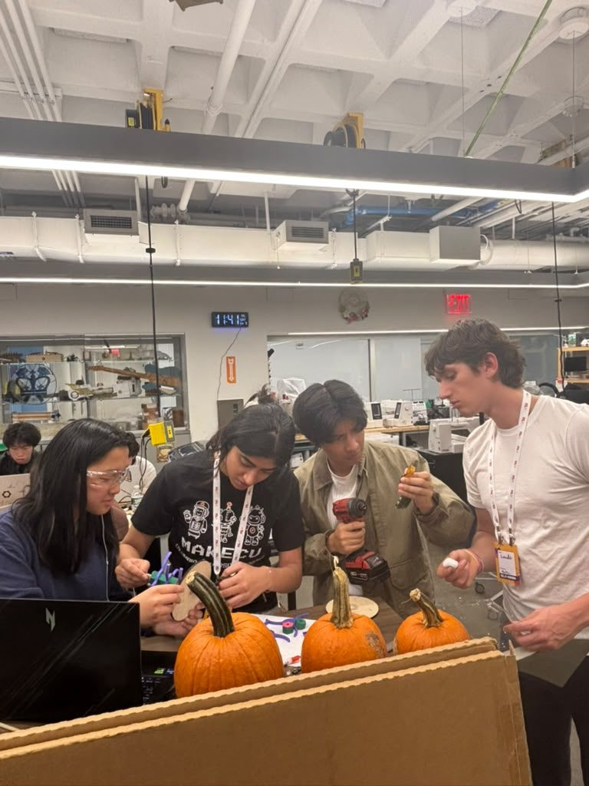
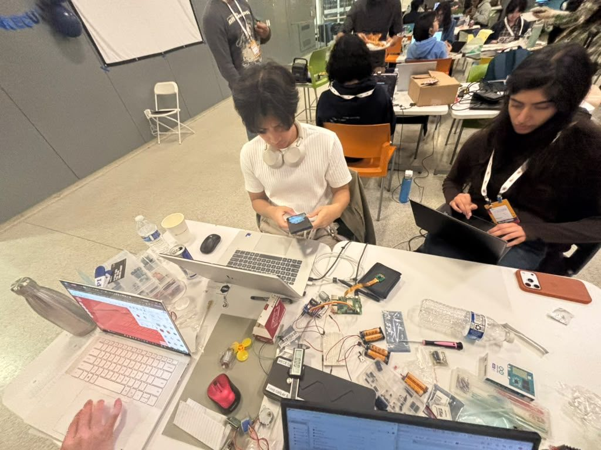

# Hardware

## Parts

| Qty | Part | Notes |
|---|---|---|
| 1 | Raspberry Pi 5 (4 GB) | Runs the camera, detector and motor control |
| 1 | Arducam 5MP (OV5647) camera | Needs the Pi 5 camera ribbon cable (smaller connector than older Pis) |
| 1 | microSD card, 16 GB | Raspberry Pi OS |
| 2 | L298N dual H-bridge motor driver | Board 1: drivetrain. Board 2: rake roller |
| 2 | DC gear motors | Drivetrain |
| 1 | DC motor | Rake roller |
| 2 | Laser-cut wooden wheels | |
| 1 | Laser-cut acrylic chassis | Includes a cavity for the removable leaf bin |
| 1 | Wooden leaf bin | Slides out for emptying |
| 5 | 3D-printed tine wheels | See [roller-design.md](roller-design.md) |
| 6 | 3D-printed spacers | 4 × 19 mm between wheels, 2 × 14.5 mm at the ends |
| 1 | Wooden dowel, 6.6 mm diameter, about 135 mm long | Roller shaft |
| 1 | Battery pack | Motor power |
| 1 | Buck converter | 5 V supply for the Pi |

## Wiring

Remove the **ENA and ENB jumpers** on each L298N so the Pi can control motor speed with PWM.

Tie the grounds together: Pi GND, both L298N GND terminals and the battery negative. Do **not** connect the battery positive to the Pi's 5 V pin.

### L298N #1: drivetrain (both channels)

| L298N pin | BCM GPIO | Physical pin |
|---|---|---|
| ENA | 4 | 7 |
| IN1 | 17 | 11 |
| IN2 | 27 | 13 |
| ENB | 22 | 15 |
| IN3 | 5 | 29 |
| IN4 | 6 | 31 |

### L298N #2: rake roller (channel A only)

| L298N pin | BCM GPIO |
|---|---|
| ENA | 12 |
| IN1 | 16 |
| IN2 | 20 |

Channel B on board 2 is unused, so BCM 13, 19 and 26 stay free.

These pin numbers come from `drive.py` and `pickup.py` in [lynnlo/leaf-detector](https://github.com/lynnlo/leaf-detector). If you change the wiring, change it there too.

## Power notes

- Give the Pi its own regulated 5 V supply. Motor start-up current can pull the voltage down and reboot the Pi.
- The L298N drops around 2 V internally, so the motors see less than the battery voltage.

  
  

